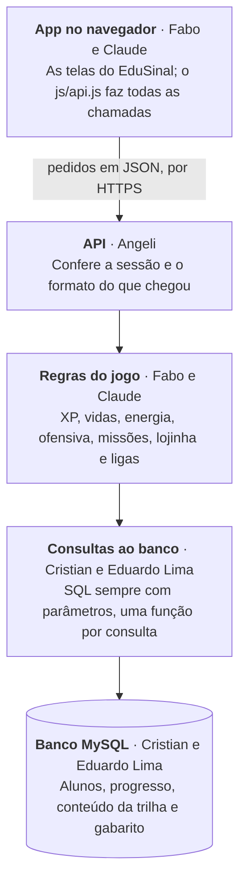

# Planejamento do back-end do EduSinal

> Cópia de 27/10/2026 do documento de planejamento da equipe. As aprovações, os comentários e as caixinhas são marcados lá: <https://claude.ai/artifact/JN1stVyVDX7MKhgCRMSpi7>. Quando o contrato for aprovado, esta cópia é atualizada e as mudanças passam a entrar por pull request.

O back-end do EduSinal se divide em três partes que já existem como pastas no código: o banco, a API e as regras. Cada parte fica com uma pessoa ou dupla, e as três combinam um contrato (tabelas e rotas) antes de programar.

## Visão geral



O app nunca fala direto com o banco. Toda chamada passa pela API, que confere quem está logado, e pelas regras, que decidem XP, vidas e moedas.

## Quem faz o quê

Cada parte cuida de uma camada do código. A rota chama a regra, a regra chama a consulta e a consulta fala com o banco.

| Quem | Parte | Onde fica no código | O que entrega |
| --- | --- | --- | --- |
| Cristian e Eduardo Lima | Banco de dados | `estrutura.sql` e `src/repositories/` | As tabelas do MySQL, os dados de exemplo e as consultas SQL que leem e gravam |
| Angeli | API | `src/controllers/` e `src/schemas/` | As rotas (os endereços que o app chama), o formato dos dados que entram e saem e a documentação em `/docs` |
| Fabo e Claude | Regras e ligação com o app | `src/services/` e a pasta `frontend` | As regras do jogo (XP, vidas, energia, ofensiva, missões, lojinha, ligas), o login seguro e o app usando a API |
| Erick | Acessibilidade e testes | O app inteiro e os pull requests de todos | Testa cada pull request no celular e no computador e confere a acessibilidade: leitor de tela, contraste, texto grande e uso só com o teclado |

Cada um trabalha numa branch própria no Git e junta na `main` por pull request, revisado por alguém de outra parte.

**Usando outras IAs para ajudar:** pode, com dois cuidados. Ninguém cola o `.env`, senhas ou dados de alunos numa IA. E todo código feito com IA passa por teste e revisão antes de entrar na `main`, conferindo se segue o contrato abaixo, porque cada IA tende a inventar um jeito diferente.

## Tecnologias

Todos usam as mesmas versões, que já estão no `requirements.txt` da pasta `backend/api/edusinal-api`. Instalar outra versão ou outra biblioteca só depois de combinar com a equipe.

| Ferramenta | Versão | Para que serve | Quem mais usa |
| --- | --- | --- | --- |
| MySQL | 8.0 ou mais novo | O banco de dados. SQL é a linguagem usada para falar com ele | Cristian e Eduardo |
| Python | 3.12 | A linguagem do back-end | Todos |
| FastAPI | 0.141.1 | Monta a API: as rotas e a documentação automática em `/docs` | Angeli |
| Pydantic | 2.13.4 | Confere se os dados que chegam e saem estão no formato certo | Angeli |
| mysql-connector-python | 26.7.0 | Liga o Python ao MySQL | Cristian e Eduardo |
| Uvicorn | 0.52.4 | Deixa a API rodando, no computador ou no servidor | Todos |
| argon2-cffi | a combinar (falta instalar) | Guarda a senha embaralhada (hash), nunca o texto | Fabo e Claude |
| unittest e `TestClient` do FastAPI | já vêm com o Python e o FastAPI | Testes automáticos das regras e das rotas | Todos |
| HTML, CSS e JavaScript puro | — | As telas do app, que chamam a API com `fetch` | Fabo e Claude |

O `estrutura.sql` usa recursos do MySQL 8.0, por isso versões mais antigas dão erro ao criar as tabelas.

## Como trabalhar no Git

A `main` é o que a Vercel publica no site, então ninguém envia nada direto para ela. Todo trabalho passa por uma branch e um pull request.

1. Uma vez só: `git clone https://github.com/Fabio-Arthur/Edu-Sinal.git`.
2. Antes de cada tarefa, pegar a versão mais nova: `git checkout main` e depois `git pull`.
3. Criar uma branch com o seu nome e o assunto: `git checkout -b angeli/rotas-login`.
4. Fazer commits pequenos, com a mensagem em português dizendo o que mudou, por exemplo "Rota de login com mensagem de erro única".
5. Enviar a branch com `git push -u origin angeli/rotas-login` e abrir um pull request no GitHub.
6. Alguém de outra parte revisa o código, e o Erick testa no celular e no computador. Só depois do ok o pull request entra na `main`.
7. Se aparecer conflito, chamar quem mexeu no mesmo arquivo antes de resolver, para ninguém apagar o trabalho do outro.

## O contrato

Antes de programar, as três partes aprovam juntas estas duas listas. Com elas combinadas, cada parte trabalha sem esperar a outra. O ponto de partida é o que o app já guarda hoje no navegador e o que já existe em `backend/api/edusinal-api`.

**Tabelas do banco**

| Tabela | O que guarda | Situação hoje |
| --- | --- | --- |
| `alunos` | Apelido, e-mail, senha (só o hash), meta diária, data de cadastro | Existe, mas precisa mudar: sair CPF, telefone e data de nascimento; entrar senha e meta |
| `sessoes` | Quem está logado: o hash do código da sessão, o aluno, quando foi criada e quando expira (7 dias). Ver "Como funciona o login" | Nova |
| `progresso_aluno` | XP, moedas, vidas, energia, ofensiva, protetores, liga, XP da semana | Existe; faltam energia, protetores e liga. Moedas iniciais: 20, como no app (hoje está 40) |
| `dias_praticados` | Dias com prática ou salvos pelo protetor (o calendário) | Nova |
| `etapas`, `atividades`, `perguntas`, `opcoes` | O conteúdo da trilha e o gabarito | Parcial: hoje só existe `respostas_atividade`, com o gabarito |
| `atividades_concluidas` | O que cada aluno concluiu, inclusive as letras do alfabeto | Existe |
| `tentativas_atividade` | Cada resposta enviada, para a recompensa não sair duas vezes | Existe |
| `missoes_resgatadas` | Missões do dia e da semana já resgatadas | Nova |
| `itens_aluno` e `mascote_aluno` | Itens do mascote que o aluno tem e o visual que está usando | Nova |
| `sinais_vistos` | Sinais do dicionário já abertos | Nova |
| `professores` | Perfil de professor | Sai: o app só tem o perfil de aluno (decidido) |

**Rotas da API**

| Método | Rota | Para que serve |
| --- | --- | --- |
| `POST` | `/auth/cadastro` | Criar a conta (apelido, e-mail, senha, meta diária) |
| `POST` | `/auth/login` | Entrar |
| `POST` | `/auth/sair` | Sair |
| `GET` | `/eu` | Perfil e progresso de quem está logado |
| `DELETE` | `/eu` | Apagar a conta e todos os dados dela |
| `GET` | `/trilha` | Etapas e o que o aluno já fez |
| `GET` | `/atividades/{id}` | Perguntas de uma atividade, sem o gabarito |
| `POST` | `/atividades/{id}/respostas` | Conferir uma resposta (errar gasta uma vida) |
| `POST` | `/atividades/{id}/concluir` | Concluir e receber XP e moedas |
| `GET` | `/missoes` | Missões do dia e da semana com o progresso |
| `POST` | `/missoes/{id}/resgatar` | Resgatar as moedas de uma missão |
| `GET` | `/lojinha` | Vitrine do dia e ajudas |
| `POST` | `/lojinha/compras` | Comprar um item ou uma ajuda |
| `PUT` | `/mascote` | Trocar o visual do mascote |
| `GET` | `/ligas/semana` | Ranking da semana |
| `GET` | `/calendario?mes=2026-10` | Dias praticados de um mês |
| `POST` | `/dicionario/{sinal}/visto` | Marcar um sinal como visto |

Três regras valem para todas as rotas:

- O número do aluno nunca vai no endereço. O servidor sabe quem é pela sessão. As rotas atuais `/alunos/{id_aluno}/...` deixam qualquer um ver os dados de outro aluno e saem.
- Os dados vão em JSON, com nomes em português no formato `id_aluno`, como no banco, e datas no formato `2026-10-27T10:00:00-03:00`.
- Quem decide se a resposta está certa é o servidor, nunca o app.

## Regras do jogo, com os números

Estes números são os que o app usa hoje (pasta `frontend/app/prototipo/js`). O servidor repete exatamente os mesmos. Mudar um número é decisão da equipe, nunca de uma pessoa ou de uma IA sozinha.

| Regra | Como funciona |
| --- | --- |
| Vidas | Máximo 3. Errar uma pergunta gasta 1, e 1 volta a cada 30 min. Sem vidas, não dá para começar exercícios. Atividades de aprender (só cartões) não usam vidas |
| Energia | Máximo 5. Concluir uma atividade nova gasta 1, e 1 volta a cada 3 h. Refazer o que já fez é revisão e não gasta. Sem energia, só dá para revisar |
| XP | 20 por atividade nova concluída, inclusive a prova final e o Desafia-me. Refazer não dá XP |
| Moedas | 20 de boas-vindas ao criar a conta. A primeira atividade concluída dá +15 moedas e o broche do mascote; as seguintes, +5 cada |
| Ordem da trilha | Cada etapa tem 5 atividades em ordem: a 2ª abre depois da 1ª, e assim por diante. A próxima etapa abre quando a prova final da anterior é aprovada |
| Prova final | Abre depois das 5 atividades. Tem 6 perguntas (as 2 primeiras de cada exercício) e pode errar no máximo 1 |
| Segunda chance | Nos exercícios, a pergunta errada volta uma vez no fim. Na prova final e no Desafia-me, não volta |
| Ofensiva | Sobe 1 no primeiro exercício novo de cada dia. Um dia sem praticar zera a ofensiva, a não ser que o aluno tenha protetor: 1 protetor salva 1 dia perdido. Guarda no máximo 2 |
| Meta diária | 1, 3 ou 5 atividades por dia, escolhida no cadastro (o padrão é 3) |
| Missões do dia | Concluir a meta do dia (+10 moedas). Ganhar meta × 20 XP (+10). Ver 3 sinais no dicionário (+5) |
| Missões da semana | Ganhar 200 XP na semana (+30 moedas). Chegar a 5 dias de ofensiva (+20) |
| Ajudas da lojinha | Recarga de energia: 40 moedas, 1 por dia. Recarga de vidas: 30. Protetor de ofensiva: 50, guardando no máximo 2 |
| Vitrine do dia | 3 itens do mascote, de tipos diferentes, sorteados pela data, iguais para todos no mesmo dia. Preços de 20 a 60 moedas. Item com preço só é vendido no dia em que está na vitrine |
| Desafia-me | Abre com 5 letras aprendidas. 5 perguntas, pode errar no máximo 1. Dá +20 XP e +10 moedas uma vez por dia; no resto do dia é treino livre |
| Ligas | Bronze, Prata, Ouro, Safira e Diamante. O ranking é pelo XP da semana: os 3 primeiros sobem e os 2 últimos descem |
| Virada do dia e da semana | O dia vira à meia-noite no horário de Brasília, e a semana vira na segunda-feira. O banco guarda as horas em UTC, e o servidor converte |

Os ids das atividades seguem o formato `etapa:atividade`, como `numeros:pratica-um-a-cinco`, e as letras do alfabeto ficam como `alfabeto:A`. Esses ids já estão salvos no app e precisam ser os mesmos no banco.

## Como funciona o login

O servidor lembra quem está logado por um código secreto guardado num cookie que o JavaScript não consegue ler. Assim, nem um script malicioso rouba a sessão.

**Cadastro** (`POST /auth/cadastro`)

1. O app envia apelido, e-mail, senha e meta diária.
2. O servidor confere com as mesmas regras do app: apelido de 2 a 20 caracteres, e-mail válido e senha com pelo menos 8 caracteres, letra maiúscula, letra minúscula, número e símbolo.
3. A senha é guardada só como hash Argon2.
4. A conta já sai logada, como no app hoje.

**Login** (`POST /auth/login`)

1. O app envia e-mail e senha.
2. E-mail que não existe e senha errada recebem a mesma resposta: 401, "E-mail ou senha incorretos". Assim ninguém descobre quais e-mails têm conta.
3. Se acertou, o servidor cria um código aleatório com `secrets.token_urlsafe(32)` e guarda na tabela `sessoes` só o hash desse código, com validade de 7 dias.
4. O código vai para o navegador num cookie chamado `sessao`, com `HttpOnly`, `Secure` e `SameSite=Lax`.

**Em cada pedido**, o navegador manda o cookie sozinho. A API procura a sessão: se não achar ou se venceu, responde 401 e o app volta para a tela de login. **Sair** (`POST /auth/sair`) apaga a sessão do banco e o cookie.

**O detalhe que mais dá problema:** navegadores bloqueiam cookie entre sites diferentes. Se o app estiver em `edu-sinal-frontend.vercel.app` e a API em outro endereço, o login não funciona. A proposta é o app chamar `/api/...` no próprio endereço da Vercel, e a Vercel repassar para a API (um "rewrite" no `vercel.json`). Isso entra na análise de onde publicar. No computador, durante o desenvolvimento, o `fetch` usa `credentials: "include"` e a API libera o `localhost` no CORS com `allow_credentials=True`.

## Exemplos de chamadas

Estes exemplos fixam os nomes dos campos. Quem fizer uma rota nova segue o mesmo jeito: campos em português, sem acento, separados por `_`.

**Login** — `POST /auth/login`

```json
{ "email": "mari@exemplo.com", "senha": "Exemplo#2026" }
```

Resposta 200 (e o cookie `sessao`):

```json
{ "apelido": "Mari", "meta_diaria": 3 }
```

**Quem sou eu** — `GET /eu`, resposta 200:

```json
{
  "apelido": "Mari",
  "meta_diaria": 3,
  "progresso": {
    "xp": 260, "moedas": 85,
    "vidas": 2, "proxima_vida_em": "2026-10-27T10:30:00-03:00",
    "energia": 5, "proxima_energia_em": null,
    "ofensiva": 5, "protetores": 1, "liga": "bronze"
  }
}
```

**Responder uma pergunta** — `POST /atividades/numeros:pratica-um-a-cinco/respostas`. O `id_tentativa` é criado pelo app e garante que a mesma resposta enviada duas vezes conta uma vez só.

```json
{ "id_tentativa": "3f2a9c1e-5b7d-4e8a-9c21-7d4e5f6a8b90", "pergunta": 0, "resposta": 1 }
```

Resposta 200:

```json
{ "correta": false, "resposta_certa": 1, "explicacao": "Esse é o sinal do número 3.", "vidas": 2, "volta_no_fim": true }
```

**Concluir** — `POST /atividades/numeros:pratica-um-a-cinco/concluir`, resposta 200:

```json
{ "primeira_vez": true, "xp_ganho": 20, "moedas_ganhas": 5, "energia": 4 }
```

**Erros** sempre no formato `{ "detail": "Mensagem em português para mostrar ao aluno." }`, com estes códigos:

| Código | Quando usar |
| --- | --- |
| 200 | Deu certo |
| 201 | Criou algo: conta, compra |
| 400 | O pedido não faz sentido, como comprar um item que não está na vitrine |
| 401 | Sem sessão, sessão vencida ou login errado |
| 404 | Não existe: atividade, item, rota |
| 409 | Não dá agora: sem energia, sem vidas, atividade trancada, moedas insuficientes, e-mail já cadastrado |
| 422 | Formato errado. O FastAPI responde sozinho |
| 429 | Muitas tentativas de login seguidas |

## Aprovação do contrato

O portão da fase 0 só abre quando os seis marcarem, no documento de planejamento (link no topo). Quem discordar de algo deixa um comentário no trecho, em vez de marcar, e a equipe resolve antes de começar a programar.

- [ ] Cristian
- [ ] Eduardo Lima
- [ ] Angeli
- [ ] Erick
- [ ] Fabo
- [ ] Claude (revisa as respostas e os comentários)

## Banco de dados (Cristian e Eduardo Lima)

O banco é a primeira peça que as outras partes precisam de verdade, então o desenho das tabelas vem antes de tudo.

- [ ] Instalar o MySQL e rodar o `estrutura.sql` atual, seguindo "Preparar a API e o MySQL" no README do projeto.
- [ ] Desenhar o diagrama do banco (tabelas e ligações) com as tabelas do contrato e apresentar para a equipe.
- [ ] Mudar a tabela `alunos`: tirar CPF, telefone e data de nascimento; incluir `apelido`, `senha_hash` e `meta_diaria`.
- [ ] Criar as tabelas novas do contrato, com `ON DELETE CASCADE` ligado ao aluno, para que apagar a conta apague tudo.
- [ ] Passar o conteúdo da trilha para o banco: 8 etapas, 40 atividades e 120 perguntas com gabarito. Hoje ele está em `frontend/app/prototipo/js/conteudo.js`, e o Claude pode gerar o script de inserts a partir dele.
- [ ] Escrever as consultas em `src/repositories/`, uma função por consulta, sempre com parâmetros. Texto digitado pelo usuário nunca entra colado no SQL.
- [ ] Criar um script de dados de teste só com alunos fictícios, sem nenhum dado real.
- [ ] Criar índices para as consultas mais usadas: progresso do aluno, atividades concluídas e ranking da semana.

## API (Angeli)

A API começa com dados de exemplo fixos, para o app poder testá-la antes de o banco ficar pronto.

- [ ] Rodar a API atual e abrir `http://127.0.0.1:8000/docs` para conhecer as rotas que já existem.
- [ ] Escrever os formatos de entrada e saída de cada rota do contrato, em `src/schemas/`.
- [ ] Criar as rotas devolvendo dados de exemplo fixos e conferir cada uma no `/docs`.
- [ ] Fazer cadastro, login e sair junto com Fabo e Claude. A regra da senha fica em `src/services/`.
- [ ] Proteger as rotas: sem sessão válida, a resposta é 401, e o aluno só acessa os próprios dados.
- [ ] Padronizar os erros, com mensagens em português. Login errado tem sempre a mesma mensagem, sem dizer se o e-mail existe.
- [ ] Liberar o acesso (CORS) só para os endereços do app: o da Vercel e o `localhost`.
- [ ] Limitar as tentativas de login (por exemplo, 5 por minuto) para dificultar quem tenta adivinhar senha.
- [ ] Trocar os dados de exemplo pelas regras e consultas de verdade, conforme ficarem prontas.
- [ ] Tirar as rotas antigas `/alunos/{id_aluno}/...` e as de professores.
- [ ] Testar cada rota com o `TestClient` do FastAPI.

## Regras e ligação com o app (Fabo e Claude)

Hoje as regras do jogo estão dentro do app, em JavaScript. Elas passam para o servidor, em Python, com os mesmos números, e o app fica só com a tela.

- [ ] Trazer os testes automáticos do app para dentro do projeto, para nada quebrar na troca.
- [ ] Escrever as regras em `src/services/` como funções que funcionam sem banco: vidas (3, uma volta a cada 30 min), energia (5, uma volta a cada 3 h, revisão não gasta), ofensiva e protetor, XP e moedas (20 XP por atividade nova, nunca duas vezes), missões (seguem a meta diária), lojinha (vitrine sorteada pela data) e ligas (sobe e desce na semana).
- [ ] Testar cada regra em `tests/`, como já é feito com `test_vidas_service.py`.
- [ ] Guardar a senha só como hash (Argon2 ou bcrypt) e a sessão num cookie seguro (`HttpOnly`), combinando com a Angeli.
- [ ] Criar `js/api.js` no app: um lugar só para as chamadas, com "carregando..." e um aviso quando a internet falha.
- [ ] Trocar o que hoje fica salvo no navegador pela API, tela por tela: cadastro e login, depois trilha e atividade, depois o resto.
- [ ] Colocar "Apagar minha conta" nas Configurações, chamando `DELETE /eu`.
- [ ] Testar o caminho inteiro (cadastro, atividade, recompensa) com o MySQL de verdade antes de publicar.

## Ordem das fases

Depois do contrato, as três partes trabalham ao mesmo tempo. Só se passa de fase quando o portão está cumprido. As datas são uma estimativa para entregar por volta de 30/11, com 29 e 30/11 de folga para imprevistos.

| Fase | Datas | Banco (Cristian e Eduardo) | API (Angeli) | Regras e app (Fabo e Claude) |
| --- | --- | --- | --- | --- |
| 0 · Contrato | 28/10 a 02/11 | Desenhar as tabelas e responder as perguntas | Listar as rotas e os formatos | Trazer os testes do app para o projeto |
| | | **Portão: contrato aprovado pelas três partes** | | |
| 1 · Em paralelo | 03/11 a 13/11 | Criar as tabelas e cadastrar o conteúdo | Rotas com dados de exemplo no `/docs` | Regras em Python, cada uma com teste |
| | | **Portão: cada parte testada sozinha** | | |
| 2 · Juntar | 14/11 a 21/11 | Consultas ligadas às regras | Login e rotas protegidas | Senha e sessão, junto com a Angeli |
| | | **Portão: cadastro, atividade e recompensa funcionando com o MySQL** | | |
| 3 · App no ar | 22/11 a 28/11 | Banco no ar, com cópia de segurança | API no ar, só com HTTPS | App usando a API, tela por tela |

## Cuidados obrigatórios

A API só vai para a internet quando login, proteção das rotas e "apagar conta" estiverem prontos, porque o app pode ter crianças e adolescentes.

- **Só os dados necessários** (LGPD, art. 6º): apelido, e-mail e senha. Nada de CPF, telefone, endereço, foto ou data de nascimento.
- **Crianças:** a LGPD, no art. 14, exige consentimento específico de um dos pais ou responsável para tratar dados de crianças. Se o app for para crianças, o cadastro ganha um passo para o responsável.
- **Senha:** guardada só como hash. Nunca aparece em log, em resposta da API nem em mensagem de erro.
- **Apagar conta:** apaga todos os dados do aluno de uma vez (LGPD, art. 18).
- **Segredos fora do Git:** o arquivo `.env`, com a senha do banco, nunca vai para o repositório.
- **Conexão segura:** a API publicada só aceita HTTPS, e o cookie da sessão é `Secure`.
- **Ranking sem exposição:** aparecem só apelido e avatar, e não existe chat entre alunos, como já é no app.
- **Logs sem dados pessoais:** registrar o que deu erro, nunca o e-mail ou as respostas do aluno.

## Decisões e propostas

A equipe já decidiu quatro pontos. Os outros são propostas que ainda precisam do ok de todos.

**Decidido**

- **Só existe o perfil de aluno.** Professores e responsáveis ficam fora, por causa do ECA e para não misturar crianças e adultos no mesmo sistema. As tabelas e rotas de professores saem.
- **Prazo:** entrega por volta do fim de novembro de 2026 e apresentação no começo de dezembro.
- **Ligas com alunos de verdade**, sem chat entre eles.
- **Onde publicar:** Fabo e Claude analisam as opções e trazem para a equipe.

**Propostas (precisam do ok da equipe)**

- [ ] **Idade:** qualquer pessoa usa o app sem conta, com o progresso só no aparelho, e nenhum dado vai para o servidor. Para criar conta, o cadastro pergunta "Você tem 12 anos ou mais?". Quem tem menos pede para um responsável confirmar. Vale conferir com o orientador.
- [ ] **Nome na liga:** o app gera um nome de jogador a partir de uma lista feita pela equipe, como "Coruja Azul 27". O apelido livre aparece só para a própria pessoa. Assim não tem palavrão nem nome real no ranking. Um filtro de palavras sozinho é fácil de burlar ("p0rr4", letras separadas, acentos).
- [ ] **Corte pelo prazo:** primeiro o essencial (cadastro e login, perfil e progresso, trilha, atividades e recompensas). Missões, lojinha, mascote, ligas e calendário ficam para "se der tempo" e continuam funcionando no aparelho até lá.
- [ ] **Preferências de tela** (tema, tamanho do texto, animações) ficam no aparelho, porque cada tela é diferente.
- [ ] **Progresso do protótipo:** quem já usa o app começa do zero ao criar conta, porque era demonstração.
